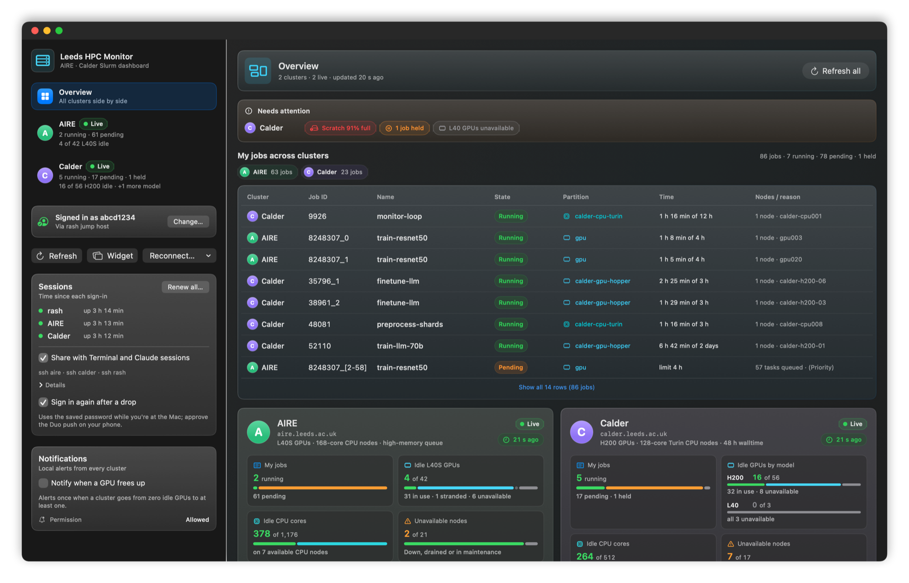
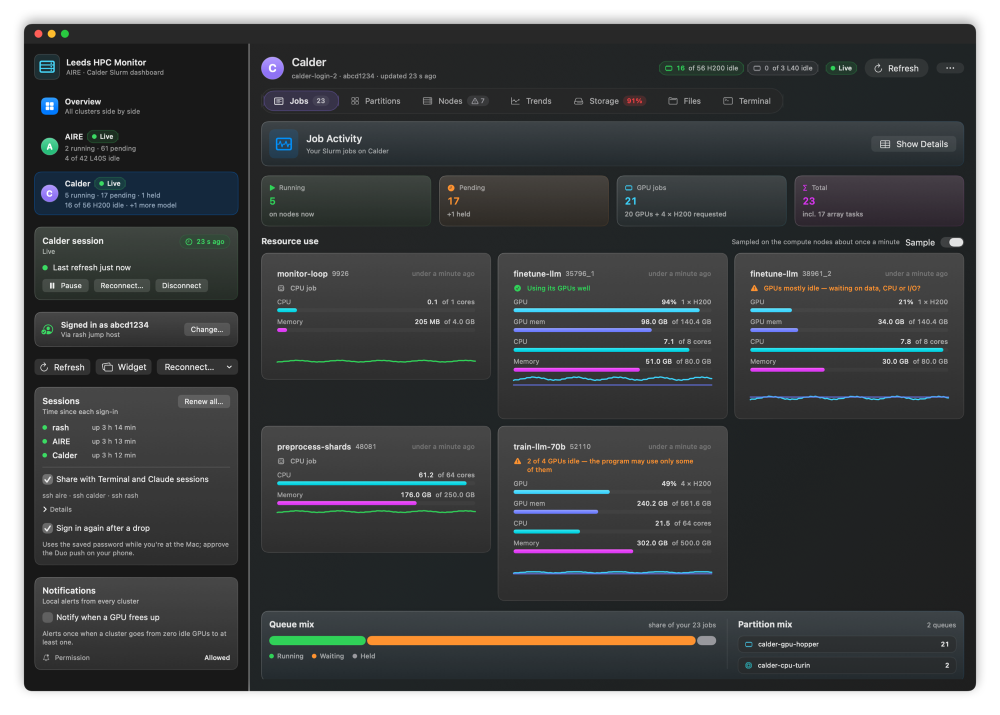
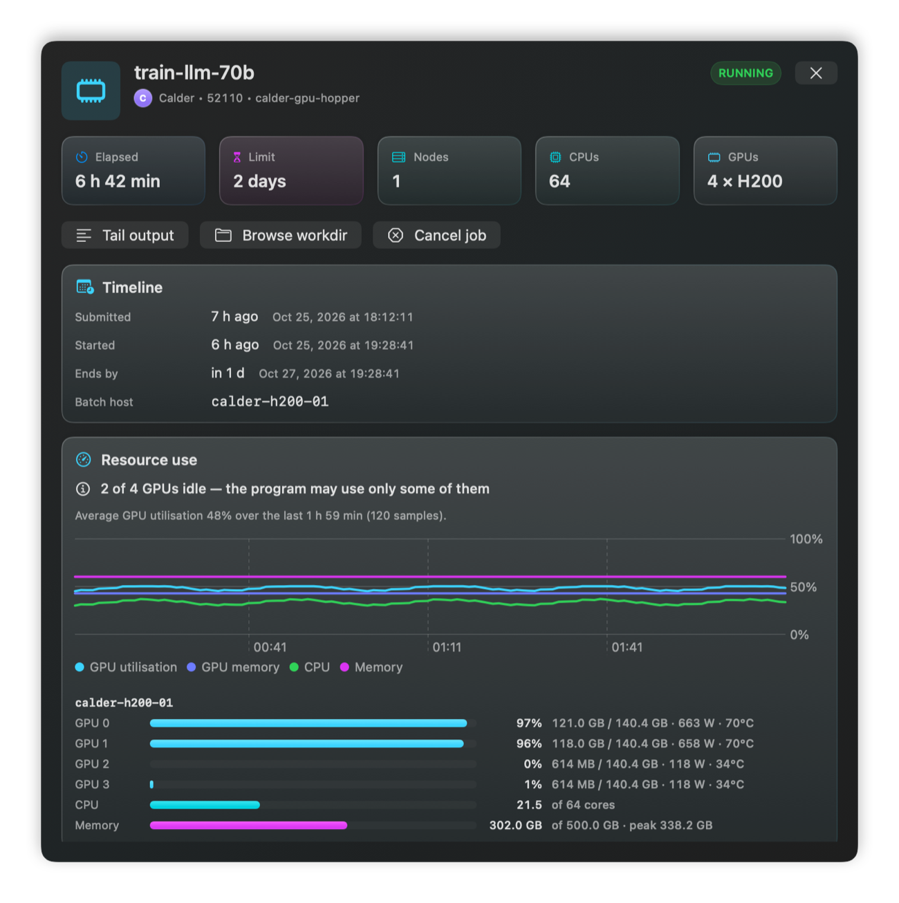
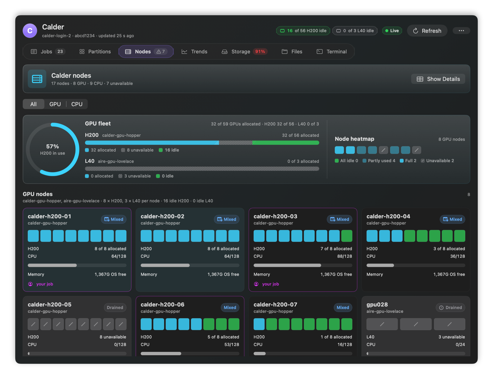
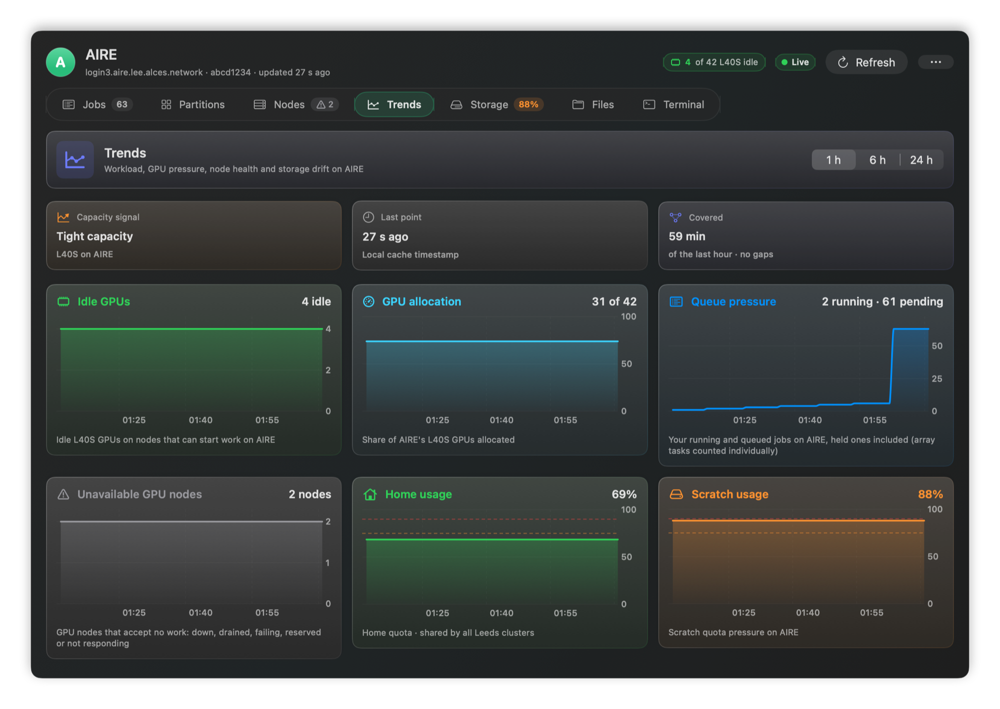
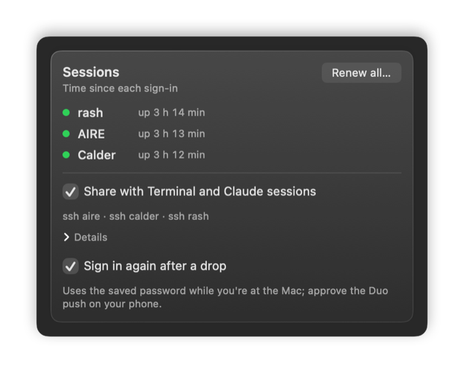
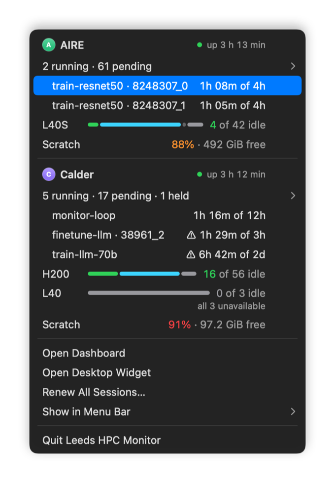
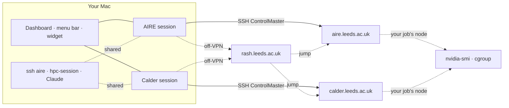

<p align="center">
  
</p>

<h1 align="center">Leeds HPC Monitor</h1>

<p align="center">
  A native macOS dashboard for the University of Leeds <b>AIRE</b> and <b>Calder</b> Slurm clusters.<br>
  Jobs, GPUs, nodes, storage, a terminal and a file manager, for both clusters at once.<br>
  It can also tell you whether your job is actually using the GPUs it asked for.
</p>

<p align="center">
  <a href="https://github.com/Jarm1ng/aire-monitor/actions/workflows/tests.yml"></a>
  
  
  
</p>

<p align="center">
  <picture>
    <source media="(prefers-color-scheme: dark)" srcset="docs/images/overview-dark.png">
    <source media="(prefers-color-scheme: light)" srcset="docs/images/overview-light.png">
    
  </picture>
</p>

Sign in once with your university account, approving Duo on your phone. The app then keeps a live, read-only view of your work on every Leeds cluster:
- which jobs are running or queued, and what they really use on their nodes;
- where free GPUs are right now;
- how full your home, scratch and flash spaces are;
- how all of that changed over time.

It refreshes every 10 seconds over persistent SSH sessions. Terminal, `scp`, `rsync` and your Claude Code sessions (Anthropic's AI coding agent) can share those same sessions, so a password and a Duo push are needed once, not for every connection.

> An independent open-source tool, not an official University of Leeds product. The logo is project branding and does not reproduce the University crest. Screenshots show demo data.

## Highlights

- **Both clusters side by side.** AIRE (L40S GPUs) and Calder (H200 GPUs, plus a few L40 nodes) each have their own session, refresh loop, cache and terminals. Combined views label every number by cluster and never add different GPU models together.
- **Is my job using its GPUs?** Once a minute, each running job is sampled on its compute nodes: GPU utilisation and memory per GPU, CPUs busy against CPUs allocated, and memory against the limit. You get a verdict such as *"2 of 4 GPUs idle"* and a two-hour trend.
- **One sign-in for everything.** Your own `ssh aire` and `ssh calder` aliases (and `ssh rash` on the rash route) ride the app's sessions, and `hpc-session` gives scripts and Claude sessions access that never prompts.
- **Made for a laptop.** Each session shows how long it has been up, and **Renew all** restarts every clock before a long night of jobs. A session that drops on sleep or a network change is noticed at once and can sign in again with one Duo approval.
- **More than a dashboard.** Up to six terminals per cluster, a file manager with a restorable Trash, a live `tail -F` of any job's output, and a confirmed **Cancel job**.
- **Always in view.** The menu bar shows how many of your jobs are running (or the idle GPUs), flags only what needs you, and opens a native menu with every cluster's jobs, GPUs and session age. A desktop widget, and alerts when a job starts or ends or a GPU frees up, cover the rest.
- **Read-only by default.** Background monitoring never submits or cancels jobs or touches your data on the clusters. Your password lives only in your Keychain and never reaches a file, a log or a command line.

## A tour

### Jobs, and what they really use

<picture>
  <source media="(prefers-color-scheme: dark)" srcset="docs/images/jobs-dark.png">
  <source media="(prefers-color-scheme: light)" srcset="docs/images/jobs-light.png">
  
</picture>

**Resource use** sits on top of the Jobs tab: one card per running job. Click a card for the job's details, with one row per GPU (utilisation, memory, power, temperature) and a chart of the last two hours.

<p align="center"></p>

How it is measured: Slurm's own accounting leaves GPU utilisation empty on both clusters, so the figures come from the compute node itself.
- Once a minute, while a job of yours runs, the login node opens an SSH connection to that job's node. The cluster allows this only on nodes running one of your jobs.
- On the node it reads `nvidia-smi` and the job's cgroup counters.
- No job step (`srun`) is started and nothing is written on the node. The cluster places that SSH session inside your job, so the probe (one `nvidia-smi` query and a one-second pause, tens of MB) runs within your allocation for about a second.

Sampling is on by default. The **Sample** switch beside the Resource use heading turns it off for both clusters and clears the figures and trend collected so far.

Every job also has a live `tail -F` of its output, a shortcut to its working directory in **Files**, and **Cancel job**, which always asks first.

### Nodes and trends



**Nodes** shows the GPU fleet per model, a heatmap, and every node's GPUs, CPUs and memory. Nodes running your jobs are marked. Down, drained and unresponsive nodes are counted apart, never as idle.



**Trends** charts idle GPUs, GPU allocation, queue pressure, unavailable GPU nodes and storage in a 1, 6 or 24-hour window. The app keeps the newest 1,440 points, about the last 4 hours at the 10-second cadence, so the longer windows show at most that.

Also per cluster: **Partitions** (capacity and walltime limits), **Storage** (home, scratch and flash against your quotas, file counts included), **Files** (preview, upload, download, rename, folder sizes, and delete to a Trash you can restore from) and **Terminal**.

### Sessions that keep up with a laptop



The **Sessions** card in the sidebar shows how long each SSH session (rash, AIRE, Calder) has been up. Past 11 hours the time turns orange: sessions have tended to end about 12 hours after the VPN session began.

- **Renew all** signs every session in again from scratch, so its clock starts over, for example before leaving jobs running overnight. It asks first: one Duo push per session, sent one at a time. Each old session closes before its new sign-in, taking with it the terminals and file transfers here and any `ssh` command a Terminal or Claude session runs over it. A cluster whose push you miss or decline stays signed out. Renewing does not restart the VPN: on the VPN, reconnect it first, or switch to the rash route.
- **Share with Terminal and Claude sessions** (on by default) links the live sessions into `~/.ssh`: `~/.ssh/ctl/<name>.sock` for each, plus a link at the `ControlPath` of each matching alias. Your existing aliases then work without a password or a Duo push: `ssh aire`, `scp`, `rsync`, and SSH from a Claude session. Because they share the app's session, `ssh -O exit aire` closes it too.
- **Sign in again after a drop** (on by default). Closing the lid or switching networks can end a session. The app notices on wake or a network change and tells you how long the session lasted. With your password saved in Keychain, it then signs in again by itself, and you approve the Duo push on your phone. It does this only while you are at the Mac, at most three times per drop, and never after a Duo push was declined or missed. Without a saved password, a dropped session waits for **Connect**.

<br clear="right">

### Menu bar and desktop widget



The menu bar item is one small rack icon with "7 running" beside it; while nothing runs, it is just the icon. It dims while nothing is live, and shows a small "!" only when something needs you:
- a session dropped;
- a sign-in failed;
- Slurm is not answering.

**Show in Menu Bar** switches the title to idle GPUs per cluster (`A 4 · C 16+`), or to the icon alone.

Click it for a native menu. Per cluster it shows:
- how long the session has been up;
- the job counts, with every job in a submenu;
- the running jobs, with ones whose GPUs sit idle listed first and marked ⚠︎;
- GPU pools, and storage only when it is filling up.

Every job opens its details, and the arrow keys and typing work as in any menu. **Renew All Sessions…** asks first, as in the sidebar. A dropped or signed-out cluster gets a one-line reason and **Connect**.

The **desktop widget** is a compact always-on-desktop panel with one row per cluster. It follows the app while the app runs, paused clusters included. While the app is closed it refreshes on its own over each cluster's still-open session (it never signs in), except clusters you paused or turned off.

**Notifications** alert you when a job starts or ends, when a session drops and, optionally, when a cluster's free GPUs go from zero to at least one.

<br clear="right">

<details>
<summary><b>Everything in each view</b></summary>

| View | What it shows |
|---|---|
| **Overview** | What needs attention first: storage over quota or 90 % full, held jobs or jobs that can never start, a GPU model with no usable node, a cluster that is not refreshing. Then your jobs from every cluster in one list. Then one card per cluster: your jobs, idle GPUs per model, idle CPU cores, storage |
| **Cluster header** | Idle GPUs per model (`6 of 84 L40S idle`), connection state, **Refresh**, and a **⋯** menu: Pause monitoring, Reconnect…, Disconnect…, Turn off. Counts sit on the tabs: jobs, unavailable nodes, storage at 75 % or more, open terminals |
| **Status strip** | Why a cluster is not updating, worded by what fixes it: a setup problem on this Mac, Slurm trouble over a live session, or no connection. **Details** shows the raw output and how many refreshes in a row failed |
| **Jobs** | Your queue with details per job, **Resource use** for running jobs, a live `tail -F`, the working directory, and a confirmed **Cancel job** |
| **Sessions** | Each session's age, **Renew all**, what happened when a session dropped, sharing and automatic sign-in |
| **Partitions / Nodes** | Partition capacity and walltime limits, the GPU fleet and heatmap, node health (down, drained, not responding) |
| **Trends** | Idle GPUs, GPU allocation, queue pressure, unavailable GPU nodes and storage in a 1, 6 or 24-hour window (about the last 4 hours are kept) |
| **Storage** | Home, scratch and flash against your quota, including file-count limits |
| **Files** | Remote file browser: preview, upload, download, rename, folder size, delete to a restorable Trash |
| **Terminal** | Up to six shells per cluster on its login node, with quick commands (`squeue --me`, `sinfo`, quota, GPU nodes). Terminal and Files work as soon as the session is up, before the first snapshot |
| **Menu bar** | "7 running" (or idle GPUs, or the icon alone), a "!" only when something needs you, and a native menu with every cluster's jobs, GPUs and warnings |
| **Desktop widget** | One row per cluster; follows the app, and while the app is closed refreshes on its own over a still-open session |
| **Notifications** | Job started or ended, a session dropped, and (optional) a GPU freed up |

GPUs whose allocation a snapshot does not report are shown as unknown (`?`), never counted as idle or in use, so a pool is never called full on a guess. Slurm job IDs repeat across clusters, so combined views keep every job tagged with its cluster; `/users` is one home quota reported by both, so it is shown once and never added up.

</details>

## Supported clusters

| | AIRE | Calder |
|---|---|---|
| Login host | `aire.leeds.ac.uk` | `calder.leeds.ac.uk` |
| GPUs | NVIDIA L40S | NVIDIA H200 (plus a few AIRE-generation L40) |
| Partitions | `nodes`, `gpu`, `himem`, `teachingnodes` | `calder-cpu-turin`, `calder-gpu-hopper`, plus the AIRE-generation `aire-gpu-lovelace` and `aire-cpu-genoa` |
| Home | `/users/<username>` (shared by both clusters) | same |
| Scratch / flash | `/mnt/scratch/<username>`, Lustre user quota | `/scratch-calder/users/<username>`, `/flash-calder/users/<username>`, Lustre project quotas |

Partitions the app has no hint for are still classified from Slurm's own data: one with GPU gres gets the GPU role, any other the CPU role. Either cluster can be switched off under **Advanced**. To add a cluster:
- add its identity (name, monogram, colour) to `ClusterIdentity.known` in [`Catalog.swift`](Sources/HPCCore/Catalog.swift);
- add one profile (hosts, storage paths, partition roles) to [`ClusterProfile.swift`](Sources/AIREMonitorApp/ClusterProfile.swift) and append it to `ClusterCatalog.all`;
- add it to `KNOWN_CLUSTER_NAMES` and `KNOWN_CLUSTER_HOSTNAMES` in [`scripts/hpc_snapshot.py`](scripts/hpc_snapshot.py) and regenerate the fixtures with `python3 scripts/tests/test_snapshot.py --write-fixture` ([details](MACOS_APP.md#cluster-profiles-and-the-catalog)).

## Quick start (macOS)

**Requirements:**
- macOS 13 or newer;
- the Xcode Command Line Tools (Swift 6);
- network access to the login hosts: on the University VPN or campus network, or through the `rash.leeds.ac.uk` jump host.

```bash
git clone https://github.com/Jarm1ng/aire-monitor.git
cd aire-monitor
./scripts/install_app.sh            # builds, installs "Leeds HPC Monitor" in /Applications, opens it
./scripts/run_desktop_widget.sh     # optional: the desktop widget (or the app's Widget button)
```

The first build takes a few minutes. From then on, open **Leeds HPC Monitor** like any other app, from Launchpad, Spotlight or the Dock.
- **Keep the checkout.** The installed app runs its helpers and keeps its data in the checkout, so leave the checkout where it is.
- **Updating.** After a `git pull`, run `./scripts/install_app.sh` again. It replaces the app only when something changed. A running copy is asked to quit the normal way, so its quit prompt still protects running terminals and transfers.
- **Install location.** Without write access to `/Applications` it installs into `~/Applications`. `HPC_INSTALL_DIR` picks another folder, and `--uninstall` removes the app.
- **Old Dock or login-item entries.** One pinned before installing still starts the old `.runtime/AIREMonitorApp.app`; replace it with the installed app.
- **Keychain prompt after rebuilds.** A self-signed code-signing certificate named `Leeds HPC Monitor Local` stops the prompt ([how](MACOS_APP.md#build-and-run)).
- **For development**, `./scripts/run_macos_app.sh` builds and opens the app straight from `.runtime/` or, once installed, updates the installed copy and opens that, rebuilding only what changed.

Then sign in from the sidebar:

1. Pick the route: **Direct (VPN)** on the VPN or campus network, **rash jump** otherwise.
2. Enter your university username and password. With **Remember in Keychain** ticked (the default), the password is saved once a server has accepted it, never by a sign-in that only reused an open session.
3. Click **Connect all** and approve the Duo pushes on your phone, one at a time. **Cancel sign-in** stops them.

## Signing in

| Route | Use it when | Duo approvals |
|---|---|---|
| **Direct (VPN)** | On the University VPN or campus network | One per cluster |
| **Via rash jump host** | Off-VPN | One for rash, then one per cluster. The rash session is shared and reused while it is healthy |

- **One account everywhere.** The same username and password work on rash, AIRE and Calder, and are stored as one macOS Keychain item.
- **Connect reuses, Reconnect… replaces.** Connect only signs in clusters that are not live. It reuses an SSH session that is still open, so there is no Duo push and terminals keep running. **Reconnect…** (in the **⋯** menu and the sidebar) and **Renew all** always ask first, then replace sessions with fresh sign-ins: one Duo push per session. The old session closes first, taking its open terminals with it, and a missed or declined push leaves that cluster signed out.
- **Switching route asks first.** Each route has its own SSH sessions, so switching closes the current ones. The app asks before that would end a live session, a running terminal or a file transfer.
- **Sessions survive restarts.** Quitting or relaunching the app does not sign you out. The app leaves a session open until 24 hours pass with nothing using it (refreshes, terminals and transfers all count). Sleep, a network change, an outage of about five minutes or the VPN ending can end it sooner (see [Sessions](#sessions-that-keep-up-with-a-laptop)). **Disconnect** closes it at once, asking first if terminals or file transfers would stop.
- **Wrong password, no retries.** A rejected or expired password cancels the queued sign-ins rather than repeating it, so the account is not pushed towards a lockout. A rejected saved password is never sent again.
- **Duo declined or timed out** is reported as exactly that: your password was accepted, and the saved password is kept. Connect again and approve the new push.
- **"Not allowed at this time" on Calder** means a busy login node refused the connection, not that the password was wrong. Wait a minute and connect again.

## Using the sessions from Terminal and Claude

While the app is signed in, your own `~/.ssh/config` aliases for AIRE and Calder (and rash, on the rash route) ride its sessions. `ssh aire`, `scp`, `rsync` and `ssh` from a Claude session need no password and no Duo. Any alias whose host and user match, and that has a `ControlPath`, works. An alias that your own live `ssh` session already holds is left alone, and is linked once that session ends.

For scripts and Claude sessions, `scripts/hpc-session` never prompts. With `--wait S` it waits up to S seconds for a down session to come back before it starts the command (the default, 0, gives up at once):

```bash
scripts/hpc-session status
```

```bash
scripts/hpc-session run calder --wait 1800 -- 'squeue --me'
```

It exits 75 when a session is down, or drops while the command runs (its output may then be incomplete); sign in again from the app and run it again. It uses the links the app keeps while **Share with Terminal and Claude sessions** is on, so with that off every session reads as down. From another directory, such as a Claude session in another project, call it by its full path in this checkout. `scripts/hpc-session help` lists every command (`status`, `check`, `wait`, `run`, `shell`).

No aliases yet? Copy the `Host` blocks you need from [`config/aire_ssh_config.example`](config/aire_ssh_config.example) into `~/.ssh/config` and fill in your username. Each has a `ControlPath`, so it rides the app's session while the app is signed in, and signs in on its own (password and Duo) when it is not.

## How it works



- **Signing in** starts one OpenSSH ControlMaster per cluster, answering the password and Duo once, or reuses one that is still open. Refreshes, terminals, file transfers and shared `ssh` commands all ride on that authenticated connection.
- **Every refresh** runs [`scripts/hpc_snapshot.py`](scripts/hpc_snapshot.py). It collects jobs, partitions, nodes and quotas in one read-only SSH round trip (rarely two) and returns JSON. Nothing is installed on the clusters.
- **Quotas** are the slowest part, so they are re-read only every 5 minutes, on a manual Refresh, and while the Storage tab is open.
- **Job usage** is sampled once a minute while you have a running job (see [the Jobs tour](#jobs-and-what-they-really-use)).
- **Local cache.** Snapshots, history and preferences are cached under `.runtime/`, so the last data stays on screen while offline.

## Privacy and safety

- **Background monitoring is read-only.** It never submits or cancels jobs or touches your data. With **Sample** on (the default) it also reaches the compute nodes of your running jobs once a minute, and a first visit to a node may add that node's host key to your cluster-side `~/.ssh/known_hosts`. Only the Terminal, the file manager and the confirmed **Cancel job** can change anything, and only when you act.
- **Your password stays out of files, logs and command lines.** It lives only in your Keychain. During sign-in it reaches the helper scripts on stdin. From there a cluster's ssh gets it through a private one-shot pipe, and on the rash route the expect helper types it at rash's ssh prompt. Every process the app starts gets an environment with any password variables removed.
- **Sharing never takes over a live session** that is not the app's, and removes the links it made when its sessions end. `hpc-session` cannot prompt or dial a host on its own.
- **Local data stays local.** Snapshots and logs live in `.runtime/` (ignored by git) and SSH sockets in `~/.ssh/ctl/` (plus, while sharing is on, links at your aliases' `ControlPath`), outside the checkout.

Details: [SECURITY.md](SECURITY.md).

## Windows and Linux

Read-only desktop ports live in [`windows/`](windows/) and [`linux/`](linux/). Both cover both clusters, SSH/Duo login, dashboards, local history, a tray icon and file/log previews, and reuse the Python collector. See [Windows](WINDOWS_APP.md) and [Linux](LINUX_APP.md) for setup, portable builds and limitations.

## Development

| Path | Contents |
|---|---|
| `Sources/AIREMonitorApp/` | The app. `ClusterProfile` defines the clusters, `ClusterSession` runs one cluster's lifecycle, and `AppModel` handles sign-in, sharing and coordination. `MonitorService` handles SSH and the collector. Then the views |
| `Sources/HPCCore/` | Shared by the app and the widget: snapshot schema, Slurm state and GPU rules, job usage, cluster identities |
| `Sources/AIREDesktopWidget/` | The standalone desktop widget |
| `scripts/` | The collector, the SSH login helpers (`hpc_*`), `hpc-session`, build, install and render scripts |
| `Tests/`, `scripts/tests/` | Swift unit and layout tests with collector fixtures; the collector's Python tests and the mock-ssh login harness |

```bash
scripts/test_all.sh                          # every suite plus a widget build, with a PASS/FAIL summary
Tests/AIREMonitorAppTests/run_tests.sh       # Swift unit and layout tests (swift-testing)
python3 scripts/tests/test_snapshot.py       # collector tests against local stubs
python3 scripts/tests/test_login_flow.py     # login scripts against a fake ssh
scripts/render_previews.sh                   # offscreen PNGs of every screen, into .runtime/previews
scripts/render_readme_images.sh              # the screenshots above, from demo data, into docs/images
```

None of the tests use the network, your Keychain or `~/.ssh`. On a Mac with only the Command Line Tools, plain `swift test` cannot find swift-testing, so use the wrapper script. [CI](.github/workflows/tests.yml) runs `scripts/test_all.sh` on every pull request and every push to `main`. Architecture, the login protocol and the runtime layout are in [MACOS_APP.md](MACOS_APP.md).

## Upgrading from AIRE Monitor

The app was renamed but keeps its internal identifiers (bundle ID `local.aire.monitor`, Keychain service, `.aire-trash`), so your notification permission, saved password and window position carry over. On first launch it:
- moves the old AIRE cache into `.runtime/clusters/aire/`;
- migrates your connection settings;
- keeps using any AIRE session that is still running, and ends the old release's keepalive so that session can now close when idle.

## Documentation

- [App internals](MACOS_APP.md) · [Security](SECURITY.md) · [Snapshot collector](MONITORING_PROTOTYPE.md) · [Login-script tests](scripts/tests/README.md)
- Cluster guides: **AIRE** ([English](AIRE_SERVER_GUIDE_EN.md), [中文](AIRE_SERVER_GUIDE.md)) · **Calder** ([English](CALDER_SERVER_GUIDE_EN.md), [中文](CALDER_SERVER_GUIDE.md))

## License

MIT — see [LICENSE](LICENSE).
