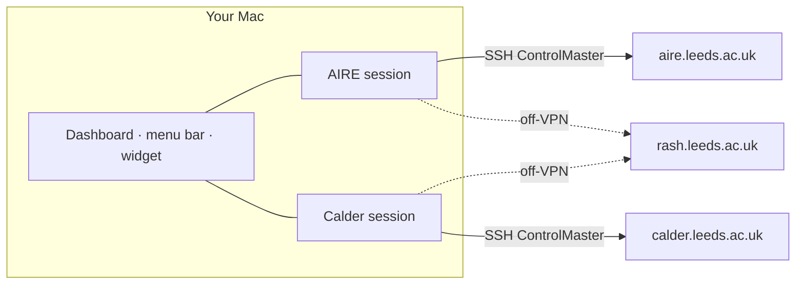

<p align="center">
  
</p>

<h1 align="center">Leeds HPC Monitor</h1>

<p align="center">
  A native macOS dashboard for the University of Leeds <b>AIRE</b> and <b>Calder</b> Slurm clusters.<br>
  Jobs, GPUs, nodes, storage quotas, a terminal and a file manager — for both clusters at once.
</p>

<p align="center">
  macOS 13+ · Swift 6 · SwiftUI · MIT
</p>

---

Sign in once with your university account and the app keeps a live, read-only view of your work on every Leeds cluster: which jobs are running or queued, where free GPUs are right now, how full your home, scratch and flash spaces are, and how all of that changed over time. It refreshes every 10 seconds over persistent SSH sessions, so you approve Duo once per cluster, not once per refresh.

> An independent open-source tool, not an official University of Leeds product. The logo is project branding and does not reproduce the University crest.

## What you get

| View | What it shows |
|---|---|
| **Overview** | One card per cluster (connection, snapshot age, jobs, idle GPUs and CPUs, storage), a *Where can I run now?* comparison, and your jobs from every cluster in one list |
| **Jobs** | Your queue with details per job, a live `tail -F` of its output, a shortcut to its working directory, and a confirmation-gated **Cancel job** |
| **Partitions / Nodes** | Partition capacity and walltime limits, a GPU fleet heatmap, and node health (down, draining, not responding) |
| **Trends** | Free GPUs, queue pressure, unavailable nodes and storage usage over time |
| **Storage** | Home, scratch and flash usage against your quota, including file-count limits |
| **Files** | A remote file browser: preview, upload, download, rename, folder size, and trash-first delete |
| **Terminal** | Embedded shells on each cluster's login node, with quick commands (`squeue --me`, `sinfo`, quota, GPU nodes) |
| **Menu bar** | Your running job, or idle GPUs per cluster (`A 6 · C 27`), plus a dropdown summary |
| **Desktop widget** | A compact always-on-desktop panel with one row per cluster |
| **Notifications** | A macOS alert when a job starts or ends, and optionally when a cluster's free GPUs go from zero to at least one |

Each cluster has its own session, refresh loop, cache, notifications, terminals and file browser, so a slow or signed-out cluster never affects the other. Combined views label every number by cluster and never add them together: L40S and H200 are different GPU pools, Slurm job IDs repeat across clusters, and `/users` is a single home quota that both clusters report.

## Supported clusters

| | AIRE | Calder |
|---|---|---|
| Login host | `aire.leeds.ac.uk` | `calder.leeds.ac.uk` |
| GPUs | NVIDIA L40S | NVIDIA H200 |
| Partitions | `nodes`, `gpu`, `himem`, `teachingnodes` | `calder-cpu-turin`, `calder-gpu-hopper` |
| Home | `/users/<username>` (shared by both clusters) | same |
| Scratch / flash | `/mnt/scratch/<username>`, Lustre user quota | `/scratch-calder/users/<username>`, `/flash-calder/users/<username>`, Lustre project quotas |

Partitions the app does not know (for example the `aire-*` nodes currently hosted by Calder's scheduler) are still classified from Slurm's own data. You can switch either cluster off under **Advanced**. Adding a cluster means adding one profile (hosts, storage paths, partition roles) to [`ClusterProfile.swift`](Sources/AIREMonitorApp/ClusterProfile.swift).

## Quick start

**Requirements:** macOS 13 or newer, the Xcode Command Line Tools (Swift 6), and network access to the login hosts — on the University VPN or campus network, or through the `rash.leeds.ac.uk` jump host.

```bash
git clone https://github.com/Jarm1ng/aire-monitor.git
cd aire-monitor
./scripts/run_macos_app.sh          # builds .runtime/AIREMonitorApp.app and opens it
./scripts/run_desktop_widget.sh     # optional: the desktop widget
```

Then sign in from the sidebar:

1. Pick the route: **Direct (VPN)** if you are on the VPN or campus network, **Via rash jump host** otherwise.
2. Enter your university username and password. With **Remember in Keychain** ticked (the default), the password is saved after the first successful sign-in.
3. Click **Connect all** and approve the Duo pushes on your phone. They arrive one at a time.

## Signing in

| Route | Use it when | Duo approvals |
|---|---|---|
| **Direct (VPN)** | On the University VPN or campus network | One per cluster |
| **Via rash jump host** | Off-VPN | One for rash, then one per cluster. The rash session is shared and reused while it is healthy |

- **One account everywhere.** The same username and password work on rash, AIRE and Calder, and are stored as one macOS Keychain item.
- **Sessions survive restarts.** SSH sessions last up to 24 hours. Quitting or relaunching the app does not sign you out.
- **Wrong password, no retries.** If the password is rejected or has expired, the remaining queued sign-ins are cancelled instead of repeating it, so the account is not pushed towards a lockout.
- **"Not allowed at this time" on Calder** is a busy login node refusing the connection, not a wrong password. Wait a minute and connect again.

## How it works



- Signing in starts one OpenSSH ControlMaster per cluster (password and Duo are answered once). Everything afterwards — refreshes, terminals, file transfers — reuses that authenticated connection.
- Every refresh runs [`scripts/hpc_snapshot.py`](scripts/hpc_snapshot.py), which collects jobs, partitions, nodes and quotas in **a single read-only SSH round trip** and returns JSON. Nothing is installed on the clusters.
- Snapshots, history and preferences are cached under `.runtime/`, so the last data stays on screen while offline.

## Privacy and safety

- **Background monitoring is read-only.** It never submits jobs or changes remote files. Only the Terminal, the file manager and the confirmed **Cancel job** can change anything, and only when you act.
- **Your password stays out of files, logs and command lines.** It lives only in your Keychain. During sign-in it reaches the helper scripts on stdin, and ssh's password prompt through a private one-shot pipe.
- **Local data stays local.** Snapshots and logs live in `.runtime/` and SSH sockets in `~/.ssh/ctl/`; both are excluded from git.

Details: [SECURITY.md](SECURITY.md).

## Development

| Path | Contents |
|---|---|
| `Sources/AIREMonitorApp/` | The app. `ClusterProfile` (cluster definitions), `ClusterSession` (one cluster's lifecycle), `AppModel` (sign-in and coordination), `MonitorService` (SSH and the collector), then the views |
| `Sources/AIREDesktopWidget/` | The standalone desktop widget |
| `scripts/` | The snapshot collector and the SSH login helpers (`hpc_*`), plus the build/run scripts |
| `Tests/`, `scripts/tests/` | Unit tests and the mock-ssh login harness |

```bash
Tests/AIREMonitorAppTests/run_tests.sh       # Swift unit tests (swift-testing)
python3 scripts/hpc_snapshot.py --self-test  # collector parsers
python3 scripts/tests/test_login_flow.py     # login scripts against a fake ssh
```

None of the tests use the network, your Keychain or `~/.ssh`. On a Mac with only the Command Line Tools, plain `swift test` cannot find swift-testing, so use the wrapper script. Architecture, the login protocol and the runtime layout are documented in [MACOS_APP.md](MACOS_APP.md).

For a plain terminal, [`config/aire_ssh_config.example`](config/aire_ssh_config.example) has ready-made `aire`, `calder`, `aire-jump` and `calder-jump` SSH aliases. The app does not need them.

## Upgrading from AIRE Monitor

The app was renamed but keeps its internal identifiers (bundle ID `local.aire.monitor`, Keychain service, `.aire-trash`), so your notification permission, saved password and window position carry over. On first launch it moves the old AIRE cache into `.runtime/clusters/aire/`, migrates your connection settings, and keeps using any AIRE session that is still running.

## Documentation

- [App internals](MACOS_APP.md) · [Security](SECURITY.md) · [Snapshot collector](MONITORING_PROTOTYPE.md) · [Login-script tests](scripts/tests/README.md)
- Cluster guides: **AIRE** ([English](AIRE_SERVER_GUIDE_EN.md), [中文](AIRE_SERVER_GUIDE.md)) · **Calder** ([English](CALDER_SERVER_GUIDE_EN.md), [中文](CALDER_SERVER_GUIDE.md))

## License

MIT — see [LICENSE](LICENSE).
