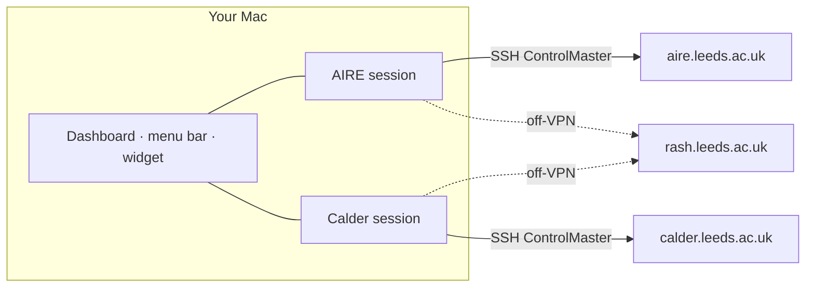

<p align="center">
  
</p>

<h1 align="center">Leeds HPC Monitor</h1>

<p align="center">
  A native macOS dashboard for the University of Leeds <b>AIRE</b> and <b>Calder</b> Slurm clusters.<br>
  Jobs, GPUs, nodes, storage quotas, a terminal and a file manager — for both clusters at once.
</p>

<p align="center">
  macOS 13+ · Swift 6 · SwiftUI · MIT
</p>

---

Sign in once with your university account and the app keeps a live, read-only view of your work on every Leeds cluster: which jobs are running or queued, where free GPUs are right now, how full your home, scratch and flash spaces are, and how all of that changed over time. It refreshes every 10 seconds over persistent SSH sessions, so you approve Duo once per cluster, not once per refresh.

> An independent open-source tool, not an official University of Leeds product. The logo is project branding and does not reproduce the University crest.

## What you get

| View | What it shows |
|---|---|
| **Overview** | What needs attention first (storage over quota or 90 % full, held jobs or jobs that can never start, a GPU model with no usable node, a cluster that is not refreshing), then your jobs from every cluster in one list, then one card per cluster: your jobs, idle GPUs per model, idle CPU cores, storage |
| **Cluster header** | Idle GPUs per model (`6 of 84 L40S idle`), connection state, **Refresh** and a **⋯** menu: Pause monitoring, Reconnect…, Disconnect…, Turn off. Counts sit on the tabs: jobs, unavailable nodes, storage at 75 % or more, open terminals |
| **Status strip** | Why a cluster is not updating, worded by what fixes it: a setup problem on this Mac, Slurm trouble over a live session, or no connection. **Details** shows the raw output and how many refreshes in a row failed |
| **Jobs** | Your queue with details per job, a live `tail -F` of its output, a shortcut to its working directory, and a confirmation-gated **Cancel job** |
| **Partitions / Nodes** | Partition capacity and walltime limits, a GPU fleet heatmap, and node health (down, drained, not responding) |
| **Trends** | Idle GPUs, GPU allocation, queue pressure, unavailable GPU nodes and storage over the last 1, 6 or 24 hours |
| **Storage** | Home, scratch and flash usage against your quota, including file-count limits |
| **Files** | A remote file browser: preview, upload, download, rename, folder size, and delete to a Trash you can restore from |
| **Terminal** | Up to six shells per cluster on its login node, with quick commands (`squeue --me`, `sinfo`, quota, GPU nodes). Terminal and Files work as soon as the session is up, before the first snapshot |
| **Menu bar** | Your running job, or idle GPUs per cluster (`A 6 · C 27`), plus a dropdown summary |
| **Desktop widget** | A compact always-on-desktop panel with one row per cluster. It follows the app, paused clusters included, and refreshes on its own only while the app is closed |
| **Notifications** | A macOS alert when a job starts or ends, and optionally when a cluster's free GPUs go from zero to at least one |

Each cluster has its own session, refresh loop, cache, notifications, terminals and file browser, so a slow or signed-out cluster never affects the other. Combined views label every number by cluster and never add them together: L40S and H200 are different GPU pools, Slurm job IDs repeat across clusters, and `/users` is a single home quota that both clusters report. GPUs whose allocation a snapshot does not report are shown as unknown (`?`), never counted as idle or in use, so a pool is never called full on a guess.

## Supported clusters

| | AIRE | Calder |
|---|---|---|
| Login host | `aire.leeds.ac.uk` | `calder.leeds.ac.uk` |
| GPUs | NVIDIA L40S | NVIDIA H200 |
| Partitions | `nodes`, `gpu`, `himem`, `teachingnodes` | `calder-cpu-turin`, `calder-gpu-hopper` |
| Home | `/users/<username>` (shared by both clusters) | same |
| Scratch / flash | `/mnt/scratch/<username>`, Lustre user quota | `/scratch-calder/users/<username>`, `/flash-calder/users/<username>`, Lustre project quotas |

Partitions the app does not know (for example the `aire-*` nodes currently hosted by Calder's scheduler) are still classified from Slurm's own data. You can switch either cluster off under **Advanced**. Adding a cluster means adding its identity (name, monogram, colour) to [`Catalog.swift`](Sources/HPCCore/Catalog.swift) and one profile (hosts, storage paths, partition roles) to [`ClusterProfile.swift`](Sources/AIREMonitorApp/ClusterProfile.swift).

## Windows version

A read-only Windows desktop port is available in [`windows/`](windows/), with
both clusters, SSH/Duo login, dashboards, local history, a tray icon and file/log
previews. It reuses the Python collector; the macOS app below is unchanged.
See [Windows setup, portable builds and limitations](WINDOWS_APP.md).

```powershell
python -m venv .venv
.\.venv\Scripts\python.exe -m pip install -r windows\requirements.txt
.\scripts\run_windows_app.ps1
```

## Linux version

A read-only Linux desktop port is available in [`linux/`](linux/), with
both clusters, SSH/Duo login, dashboards, local history, a tray icon and file/log
previews. It reuses the Python collector; the macOS app below is unchanged.
See [Linux setup, portable builds and limitations](LINUX_APP.md).

```bash
python3 -m venv .venv
./.venv/bin/python -m pip install -r linux/requirements.txt
./scripts/run_linux_app.sh
```

## Quick start (macOS)

**Requirements:** macOS 13 or newer, the Xcode Command Line Tools (Swift 6), and network access to the login hosts — on the University VPN or campus network, or through the `rash.leeds.ac.uk` jump host.

```bash
git clone https://github.com/Jarm1ng/aire-monitor.git
cd aire-monitor
./scripts/install_app.sh            # recommended: builds, installs "Leeds HPC Monitor" in /Applications, opens it
./scripts/run_desktop_widget.sh     # optional: the desktop widget (or the app's Widget button)
```

The first build takes a few minutes. From then on, open **Leeds HPC Monitor** like any other app: Launchpad, Spotlight, the Dock. The installed app still runs its helpers and keeps its data in the checkout, so leave the checkout where it is. After a `git pull`, run `./scripts/install_app.sh` again to update. It replaces the app only when something changed. A running app is asked to quit first, the normal way, so its quit prompt still protects running terminals and transfers. Without write access to `/Applications` it installs into `~/Applications`. `HPC_INSTALL_DIR` picks another folder, and `--uninstall` removes the app.

If you pinned the app to the Dock or added it as a login item before installing, that entry still starts the old `.runtime/AIREMonitorApp.app` copy. Remove it, then pin or add the installed **Leeds HPC Monitor** instead.

For development, `./scripts/run_macos_app.sh` builds and opens the app straight from `.runtime/`, or, once it is installed, updates the installed copy and opens that. Either way only what changed is rebuilt. Optional: a self-signed code-signing certificate named `Leeds HPC Monitor Local` stops the Keychain prompt after every rebuild ([how](MACOS_APP.md#build-and-run)).

Then sign in from the sidebar:

1. Pick the route: **Direct (VPN)** if you are on the VPN or campus network, **rash jump** otherwise.
2. Enter your university username and password. With **Remember in Keychain** ticked (the default), the password is saved once a server has accepted it, never by a sign-in that only reused an open session.
3. Click **Connect all** and approve the Duo pushes on your phone. They arrive one at a time; **Cancel sign-in** stops them. Once every cluster is live the form folds into one "Signed in as" line.

## Signing in

| Route | Use it when | Duo approvals |
|---|---|---|
| **Direct (VPN)** | On the University VPN or campus network | One per cluster |
| **Via rash jump host** | Off-VPN | One for rash, then one per cluster. The rash session is shared and reused while it is healthy |

- **One account everywhere.** The same username and password work on rash, AIRE and Calder, and are stored as one macOS Keychain item.
- **Connect reuses, Reconnect… replaces.** Connect only signs in clusters that are not live, and reuses an SSH session that is still open: no Duo push, and terminals keep running. **Reconnect…** (in the **⋯** menu and the sidebar) always asks first, then replaces the session with a fresh sign-in: one Duo push per cluster, and open terminals there close.
- **Switching route asks first.** Each route has its own SSH sessions, so switching closes the current ones; the app asks before that would end a live session, a running terminal or a file transfer.
- **Sessions survive restarts.** An SSH session closes only after 24 hours with nothing using it (refreshes, terminals and transfers all count) or a network outage of about five minutes, so quitting or relaunching the app does not sign you out. **Disconnect** closes it at once, asking first if terminals or file transfers would stop.
- **Wrong password, no retries.** If the password is rejected or has expired, the remaining queued sign-ins are cancelled instead of repeating it, so the account is not pushed towards a lockout. A rejected saved password is not sent again.
- **Duo declined or timed out** is reported as exactly that: your password was accepted. The queued sign-ins stop and the saved password is kept; connect again and approve the new push.
- **"Not allowed at this time" on Calder** is a busy login node refusing the connection, not a wrong password. Wait a minute and connect again.

## How it works



- Signing in starts one OpenSSH ControlMaster per cluster (password and Duo are answered once), or reuses one that is still open. Everything afterwards — refreshes, terminals, file transfers — rides on that authenticated connection.
- Every refresh runs [`scripts/hpc_snapshot.py`](scripts/hpc_snapshot.py), which collects jobs, partitions, nodes and quotas in **one read-only SSH round trip** (rarely two) and returns JSON. Nothing is installed on the clusters.
- Quotas are the slowest part, so they are re-read every 5 minutes, on a manual Refresh and while the Storage tab is open; other refreshes keep the last figures.
- Snapshots, history and preferences are cached under `.runtime/`, so the last data stays on screen while offline.

## Privacy and safety

- **Background monitoring is read-only.** It never submits jobs or changes remote files. Only the Terminal, the file manager and the confirmed **Cancel job** can change anything, and only when you act.
- **Your password stays out of files, logs and command lines.** It lives only in your Keychain. During sign-in it reaches the helper scripts on stdin, and ssh's password prompt through a private one-shot pipe. Every process the app starts (helpers, collector, terminals, transfers) gets an environment with any password variables removed.
- **Local data stays local.** Snapshots and logs live in `.runtime/` (ignored by git) and SSH sockets in `~/.ssh/ctl/`, outside the checkout.

Details: [SECURITY.md](SECURITY.md).

## Development

| Path | Contents |
|---|---|
| `Sources/AIREMonitorApp/` | The app. `ClusterProfile` (cluster definitions), `ClusterSession` (one cluster's lifecycle), `AppModel` (sign-in and coordination), `MonitorService` (SSH and the collector), then the views |
| `Sources/HPCCore/` | Shared by the app and the widget: snapshot schema, Slurm state and GPU rules, cluster identities |
| `Sources/AIREDesktopWidget/` | The standalone desktop widget |
| `scripts/` | The snapshot collector, the SSH login helpers (`hpc_*`), `build_bundle.sh`, which builds and signs both bundles for the `run_*` scripts, and `install_app.sh`, which installs the app |
| `Tests/`, `scripts/tests/` | Swift unit and layout tests with collector fixtures; the collector's Python tests and the mock-ssh login harness |

```bash
scripts/test_all.sh                          # the next three plus a widget build, with a PASS/FAIL summary
Tests/AIREMonitorAppTests/run_tests.sh       # Swift unit and layout tests (swift-testing)
python3 scripts/tests/test_snapshot.py       # collector tests against local stubs
python3 scripts/tests/test_login_flow.py     # login scripts against a fake ssh
scripts/render_previews.sh                   # offscreen PNGs of every screen, into .runtime/previews
```

None of the tests use the network, your Keychain or `~/.ssh`. On a Mac with only the Command Line Tools, plain `swift test` cannot find swift-testing, so use the wrapper script. [CI](.github/workflows/tests.yml) runs `scripts/test_all.sh` on every pull request and push to `main`. Architecture, the login protocol and the runtime layout are documented in [MACOS_APP.md](MACOS_APP.md).

For a plain terminal, [`config/aire_ssh_config.example`](config/aire_ssh_config.example) has ready-made `aire`, `calder`, `aire-jump` and `calder-jump` SSH aliases. The app does not need them.

## Upgrading from AIRE Monitor

The app was renamed but keeps its internal identifiers (bundle ID `local.aire.monitor`, Keychain service, `.aire-trash`), so your notification permission, saved password and window position carry over. On first launch it moves the old AIRE cache into `.runtime/clusters/aire/`, migrates your connection settings, and keeps using any AIRE session that is still running, ending the old release's keepalive so that session can now close when idle.

## Documentation

- [App internals](MACOS_APP.md) · [Security](SECURITY.md) · [Snapshot collector](MONITORING_PROTOTYPE.md) · [Login-script tests](scripts/tests/README.md)
- Cluster guides: **AIRE** ([English](AIRE_SERVER_GUIDE_EN.md), [中文](AIRE_SERVER_GUIDE.md)) · **Calder** ([English](CALDER_SERVER_GUIDE_EN.md), [中文](CALDER_SERVER_GUIDE.md))

## License

MIT — see [LICENSE](LICENSE).
